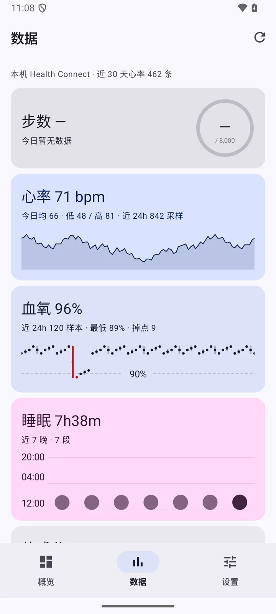
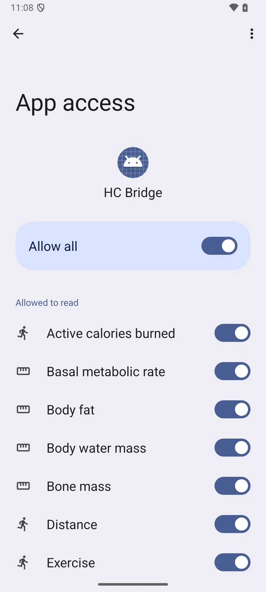
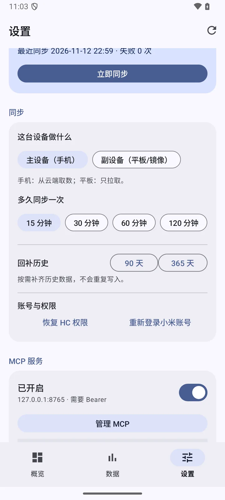
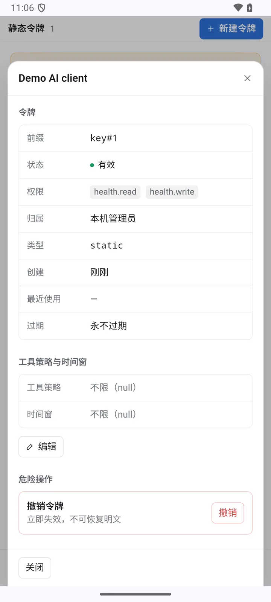

# Xiaomi Health Connect Bridge

**Keep Mi Fitness. Connect your health data to Health Connect and AI.**

Xiaomi Health Connect Bridge brings your Xiaomi health history into Android Health Connect and MCP-compatible AI tools — without replacing Mi Fitness, rooting your phone, or running a separate server.

**The Android app includes its own MCP server.** Use it directly with compatible on-device AI clients, or deploy the optional server for stable, long-running MCP access from remote or cloud-based clients.

[中文介绍](#简体中文) · [Get started](#get-started) · [How it works](#how-it-works)

## Why use it?

| | |
| --- | --- |
| **Keep using Mi Fitness** | Your Xiaomi devices and official app work as before. The bridge adds new ways to use your data without changing your routine. |
| **Connect to Health Connect** | Sync supported Xiaomi health records into Android's shared health platform for compatible, authorized apps. |
| **AI access, right on your phone** | Run MCP directly in the Android app. Ask compatible local AI clients about your sleep, heart rate and activity history — no NAS or Docker required. |
| **Control who can see what** | Manage client access with authorization, tool-level permissions, approval flows and audit records. |
| **Sync without manual exports** | Background synchronization and historical backfill keep supported records available for analysis. |
| **Always-on remote access** | An optional Docker deployment provides a continuously available MCP service for remote and cloud-based AI clients. You can publish it securely through a reverse proxy or a tunnel such as Cloudflare Tunnel. |

## See it in action

The most useful demo is a real four-step walkthrough: **Mi Fitness stays in place → data appears in Health Connect → an on-device MCP client queries it → you control the client's permissions.** See the [demo and screenshot capture guide](docs/DEMO.md).

<table>
  <tr>
    <td align="center" width="50%"><br><sub><b>Health Connect records in the app</b><br>Heart rate, oxygen saturation and sleep.</sub></td>
    <td align="center" width="50%"><br><sub><b>Health Connect grants access</b><br>You pick the record types the bridge may read and write.</sub></td>
  </tr>
  <tr>
    <td align="center" width="50%"><br><sub><b>MCP on the phone</b><br>Service on <code>127.0.0.1:8765</code>, next to the sync status.</sub></td>
    <td align="center" width="50%"><br><sub><b>Per-client permissions</b><br>Scopes, tool policy, time window, revoke.</sub></td>
  </tr>
</table>

<sub>Captured from HC Bridge 0.9.0 (build 2026-11-03) on an Android emulator with synthetic Health Connect records. No personal data.</sub>

## What can you do with it?

**See your health history in more places.** Bring supported sleep and heart-rate records into Health Connect, alongside data from other compatible apps.

**Ask questions instead of exporting files.** Connect a compatible AI assistant through MCP and explore questions such as:

> How has my sleep duration changed over the past two weeks?

> Show my resting heart-rate trend this month.

> Compare my activity across weekdays and weekends.

These are example questions; the answer depends on available records and the tools supported by the connected client.

**Keep AI access under your control.** Review client authorization requests and grant access to the tools each client needs. The Android implementation includes an on-device MCP service, an authorization consent screen and an administration interface.

## Two ways to run

| Android app | Optional Docker server |
| --- | --- |
| Health Connect sync + **on-device MCP** | Self-hosted health-data store + MCP |
| Runs on your Android phone | Runs on a NAS or other Docker host |
| Ideal for Health Connect and on-device AI clients | Ideal for persistent remote access and cloud-based AI clients |
| **No separate server needed** | Can stay online independently of the phone |

### How it works

```text
Xiaomi wearable / scale → Mi Fitness → Xiaomi cloud
                                          |
                         +----------------+----------------+
                         |                                 |
                    Android app                       Docker server
                         |                              (optional)
                 +-------+-------+                         |
                 |               |                     SQLite + MCP
            Health Connect   On-device MCP                   |
                 |               |                    Remote / cloud AI
          Compatible apps    Local AI clients               clients
```

## Get started

### Android app

Build and install the Android app (JDK 17 and Android SDK platform 36):

```bash
cd app
./gradlew assembleDebug
adb install -r build/outputs/apk/debug/app-debug.apk
```

Configure your Xiaomi cloud connection, grant the required Health Connect permissions, and start synchronization. For local AI integration, start the built-in MCP service and connect a compatible client on the same phone to:

```text
http://127.0.0.1:8765/mcp
```

### Optional Docker deployment

```bash
cd deploy/nas
cp env.example .env
# Configure your account and authentication settings
docker compose up -d
```

See [deployment](deploy/nas), [operations](OPERATIONS.md) and [acceptance guidance](deploy/nas/ACCEPTANCE.md) for setup and troubleshooting.

## Supported data and compatibility

The project handles supported records including heart rate, sleep, activity, workouts and selected body and wellness measurements. Availability varies by device, source records and destination format.

The built-in Android MCP endpoint listens on the phone's loopback interface. The MCP server runs locally; refreshing records from Xiaomi cloud can still require internet access.

This is an independent, unofficial project, not affiliated with Xiaomi or Google. See [NOTICE.md](NOTICE.md) for compatibility information. Health data is sensitive: configure client permissions and server access appropriately.

## For developers

- Android: Kotlin app, Health Connect integration, background sync, local MCP service and authorization UI.
- Server: optional Docker-based collection, storage and authenticated MCP access.
- Administration: [admin-ui/](admin-ui/).
- More detail: [docs/](docs/) and [OPERATIONS.md](OPERATIONS.md).

License: [MIT](LICENSE).

---

## 简体中文

**继续使用小米运动健康，让健康数据连接 Google Health Connect 和 AI。**

Xiaomi Health Connect Bridge 将小米健康记录同步到 Android Health Connect，并通过 MCP 让 AI 助手访问健康历史。无需 Root、不修改官方小米运动健康，也不必改变原有设备配对方式。

**Android App 自带 MCP Server，无需 NAS 或 Docker。** 兼容的同机 AI 客户端可以直接调用；需要长期稳定服务、远程调用或云端 AI 接入时，也可以部署 Docker Server。

### 四个核心卖点

| 能力 | 带来的价值 |
| --- | --- |
| **不影响小米运动健康** | 保留原有 App、设备配对与使用习惯，只增加数据的使用方式 |
| **连接 Google Health Connect** | 让支持的睡眠、心率等健康记录进入 Android 健康数据生态 |
| **本机 MCP，直接连接 AI** | 手机运行 MCP Server，兼容的本机 AI 客户端无需独立服务器即可查询健康历史 |
| **细粒度权限管理** | 管理客户端授权、可访问工具、审批和审计记录，按需开放数据 |

此外，还支持自动同步、历史数据回补，以及可选的 Docker 自托管部署。

### 你可以用它做什么？

- **跨应用使用健康数据：** 将支持的小米记录写入 Health Connect，供获得授权的兼容应用使用。
- **用 AI 分析趋势：** 询问「最近两周睡眠时长有什么变化？」「这个月心率趋势如何？」等问题，不必反复手动导出文件。
- **按客户端授权：** 为不同 AI 客户端分配需要的访问能力，并在管理界面查看授权与访问情况。
- **按需选择部署方式：** 仅安装 Android App 就能使用 Health Connect 和本机 MCP；需要长期在线服务或远程、云端访问时再部署 Docker。

### 实际演示

推荐的演示流程：**保留小米运动健康 → 同步到 Health Connect → 手机本机 MCP 查询 → 管理客户端权限**。截图和录屏规范见 [Demo 指南](docs/DEMO.md)。

<table>
  <tr>
    <td align="center" width="50%"><br><sub><b>App 里的 Health Connect 记录</b><br>心率、血氧、睡眠。</sub></td>
    <td align="center" width="50%"><br><sub><b>Health Connect 授权</b><br>读哪些、写哪些记录类型，由你勾选。</sub></td>
  </tr>
  <tr>
    <td align="center" width="50%"><br><sub><b>手机上的 MCP</b><br><code>127.0.0.1:8765</code>，紧挨着同步状态。</sub></td>
    <td align="center" width="50%"><br><sub><b>按客户端授权</b><br>权限范围、工具策略、时间窗、撤销。</sub></td>
  </tr>
</table>

<sub>截图来自 HC Bridge 0.9.0（构建 2026-11-03），运行在 Android 模拟器上，记录为合成数据，不含个人信息。</sub>

### 两种部署方式

**Android App（推荐）：** Health Connect 同步 + 本机 MCP Server。手机端直接运行，适合 Android 健康生态和本机 AI 客户端。

**Docker Server（可选）：** 面向长期稳定运行与远程、云端 AI 客户端接入。可部署在 NAS、VPS 或其他 Docker 主机上，通过反向代理或 Cloudflare Tunnel 等方式安全提供公网访问。

架构图和安装命令见上方 [How it works](#how-it-works) 与 [Get started](#get-started)。

### 使用边界

数据覆盖范围取决于小米设备、云端记录和 Health Connect 的支持情况。本机 MCP 不需要独立服务器，但从小米云端更新数据仍可能需要联网。项目为非官方开源实现，与小米、Google 无关联。

详细部署与运维信息见 [OPERATIONS.md](OPERATIONS.md)，许可证为 [MIT](LICENSE)。
